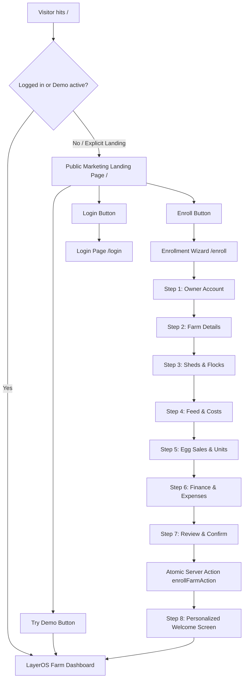

# LayerOS Public Marketing Landing Page & Farm Enrollment Documentation

## 1. Overview & Architecture

This feature adds a high-converting, mobile-first, trilingual public marketing landing page (`/`) and a guided 7-step poultry farm enrollment wizard (`/enroll`) in front of the existing LayerOS application.

### Core Ground Rules Adhered To
1. **Additive Only**: No existing calculations, DAL logic, AI advisors, billing guards, or RLS policies were modified or refactored. The root route (`app/page.tsx`) acts purely as a visitor router / handoff.
2. **Reused Foundation**:
   - Styling tokens: Forest Green (`#1F4D3A`), Egg-Gold (`#D9A441`), Ivory (`#FAF8F3`), and Noto Sans Devanagari typography.
   - Core DAL (`lib/dal`), Calculation fixtures (`lib/calc`), Unit Settings schema (`DEFAULT_UNIT_SETTINGS`), and Billing Plan configs (`lib/billing/plans.ts`).
3. **Trilingual System**: Full parity across **Marathi** (default), **Hindi**, and **English** with zero hardcoded UI strings.
4. **Mobile First**: Built and verified for 360px Android devices with 48px+ touch targets and fast SVG/CSS rendering without heavy media assets.

---

## 2. User Flows & Routing

### Route Handoff Logic (`app/page.tsx`)
- Fresh visitors arriving at `/` see the rich, 12-section marketing landing page.
- Existing sessions, active sandbox demos, and automated test environments bypass the landing view and load the dashboard directly.
- Visitors can manually view the landing page at any time via `/?landing=true` or via the top-bar farm selector menu.

---

## 3. Field-to-Database Mapping

Every field collected during the 7-step enrollment process maps directly into Supabase tables or the atomic transaction RPC `enroll_farm_atomic` (`supabase/migrations/005_farm_enrollment_and_onboarding.sql`):

| Step | Form Input Field | DB Target Table | DB Column / Parameter | Type | Validation / Constraints |
| :--- | :--- | :--- | :--- | :--- | :--- |
| **1. Owner** | Full Name | `users` | `name` | `TEXT` | Min 2 chars |
| | Mobile Number | `users` | `phone` | `TEXT` | 10 digits, Indian prefix (6-9) |
| | Email | `auth.users` / `users` | `email` | `TEXT` | Valid email format |
| | Password | `auth.users` | `encrypted_password` | `TEXT` | Min 8 chars, 1 letter, 1 number |
| | DPDP Privacy Consent | `users` | `dpdp_consent` | `BOOLEAN` | Required `true` |
| **2. Farm** | Farm Name | `farms` | `name` | `TEXT` | Min 2 chars |
| | Owner Display Name | `farms` | `owner_name` | `TEXT` | Min 2 chars |
| | Village / Town | `farms` | `village_town` | `TEXT` | Required |
| | Taluka | `farms` | `taluka` | `TEXT` | Required |
| | District | `farms` | `district` | `TEXT` | Maharashtra dropdown / text |
| | State | `farms` | `state` | `TEXT` | Default `Maharashtra` |
| | PIN Code | `farms` | `pincode` | `TEXT` | 6 digits regex |
| | Preferred Language | `farms` / `users` | `preferred_language` | `TEXT` | `mr` \| `hi` \| `en` |
| **3. Flocks** | Number of Sheds | `sheds` | (Creates `N` sheds) | `INTEGER` | Min 1, Max 50 |
| | Breed | `flocks` | `breed` | `TEXT` | Lohmann, Hy-Line, Bovans, ISA, etc. |
| | Birds Placed | `flocks` | `initial_bird_count` | `INTEGER` | Positive integer |
| | Current Live Birds | `flocks` | `current_bird_count` | `INTEGER` | Positive integer |
| | Age in Weeks | `flocks` | `age_weeks` | `INTEGER` | 1 to 120 weeks |
| | Housing Type | `flocks` | `housing_type` | `TEXT` | `cage` \| `deep_litter` |
| **4. Feed** | Feed Bags / Day | `farms` | `feed_bags_per_day` | `NUMERIC` | Positive number |
| | Feed Price / kg | `unit_settings` | `feed_cost_per_kg` | `NUMERIC` | Positive number |
| | Feed Bag Size | `unit_settings` | `feed_bag_size_kg` | `NUMERIC` | Default 50 kg |
| | Feed Supplier | `suppliers` | `name` (optional) | `TEXT` | Optional supplier record |
| | Planning Horizon | `farms` | `planning_horizon_days` | `INTEGER` | 30, 60, or 90 days |
| | Expected Feed Stock | `farms` | `expected_feed_stock_bags` | `NUMERIC` | Optional |
| **5. Sales** | Tray Size | `unit_settings` | `tray_size` | `INTEGER` | Default 30 |
| | Trays per Gatta | `unit_settings` | `trays_per_gatta` | `INTEGER` | Default 7 (210 eggs) |
| | Egg Selling Price | `unit_settings` | `egg_selling_price` | `NUMERIC` | ₹ / egg |
| | Main Buyer Type | `farms` | `main_buyer_type` | `TEXT` | Trader, Retail, Mandi |
| | Nearest Mandi | `farms` | `nearest_mandi` | `TEXT` | Pune, Mumbai, Nashik, etc. |
| **6. Finance**| Monthly Labour | `farms` | `monthly_labour_cost` | `NUMERIC` | Optional |
| | Monthly Medicine | `farms` | `monthly_medicine_cost` | `NUMERIC` | Optional |
| | Monthly Electricity | `farms` | `monthly_power_cost` | `NUMERIC` | Optional |
| | Other Monthly Expense| `farms` | `monthly_other_cost` | `NUMERIC` | Optional |
| | Loan EMI | `loans` | `monthly_emi` | `NUMERIC` | Optional |
| | Number of Employees | `farms` | `number_of_employees` | `INTEGER` | Default 2 |

---

## 4. Atomic Enrollment Execution (`enroll_farm_atomic`)

The server-side action `enrollFarmAction` in `lib/enroll/actions.ts` processes submissions atomically:
1. **Bot & Honeypot Detection**: Submissions containing the hidden `hp_field` input are rejected immediately.
2. **Rate Limiting**: IP rate limiting prevents brute-force registrations.
3. **Zod Validation**: `completeEnrollmentSchema` validates all steps on client and server simultaneously.
4. **Auth User Creation**: Creates Supabase auth account via `supabase.auth.signUp`.
5. **Database Transaction**: Invokes RPC `enroll_farm_atomic` to create farm, assign user as `owner`, insert sheds, insert flocks, save `unit_settings`, and initialize subscription tier.
6. **Rollback Guarantee**: If any flock insertion, shed creation, or settings write fails, the entire transaction rolls back cleanly, leaving no orphaned farms or partial users.
7. **Calculated First View**: Generates welcome metrics using `calculateDailyMetrics` from `lib/calc`, giving the farmer immediate insights on opening day egg potential, monthly feed bags, and break-even egg rate.

---

## 5. How to Edit Copy & Pricing

### Editing Marketing & Enrollment Copy
All user-facing copy resides in `lib/i18n/translations.ts` under the respective language dictionaries:
- `translations.mr`: Marathi (farmer-friendly Marathi vocabulary).
- `translations.hi`: Hindi (standard conversational poultry terminology).
- `translations.en`: English.

To change any headline, feature description, or FAQ answer:
1. Locate the key in `TranslationKeys` interface in `lib/i18n/translations.ts`.
2. Update the string in all 3 language blocks (`mr`, `hi`, `en`) to maintain key parity.
3. Verify key parity by running `npx vitest run lib/i18n/localization.test.ts`.

### Editing Pricing & Subscription Tiers
Pricing and plan limits are dynamically pulled from `SUBSCRIPTION_PLANS` in `lib/billing/plans.ts`:
- **Starter Plan**: ₹0 (Free trial). Bird limit: 5,000 birds.
- **Grower Pro Plan**: ₹1,499/mo (₹14,990/yr). Bird limit: 25,000 birds.
- **Commercial Enterprise**: ₹3,999/mo (₹39,990/yr). Bird limit: 100,000+ birds.

The landing page pricing teaser reads directly from `SUBSCRIPTION_PLANS`. Any price or limit update in `lib/billing/plans.ts` automatically reflects on `/` without editing components.

---

## 6. Testing & Quality Assurance

| Test Category | Suite / Command | Status | Coverage |
| :--- | :--- | :--- | :--- |
| **Unit & Integration** | `npx vitest run` | **70 / 70 passed** (100%) | Schemas, atomicity rollback, cross-tenant isolation, localization parity, DAL |
| **Playwright E2E** | `npx playwright test` | **45 / 45 passed** (100%) | 3 viewports: Chromium Desktop (1280px), Mobile Farmer (360px), Pixel 5 (393px) |
| **Typecheck** | `npx tsc --noEmit` | **0 errors** | Strict TypeScript 5 |
| **Linter** | `npm run lint` | **0 errors** | ESLint 9 & Next.js 16 rules |
| **Production Build** | `npm run build` | **0 errors** | Static prerendering of `/`, `/enroll`, `/login` |
